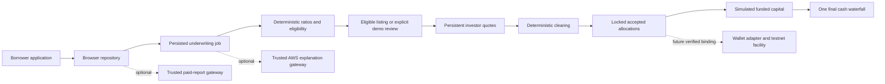

> The v0.3 backend implementation and current service boundaries are documented in [INTEGRATIONS](INTEGRATIONS.md). The preserved v0.2 frontend architecture follows.

# Architecture

BACKSTOP v0.2 uses React 19, TypeScript, and Vite. Exactly four application routes are handled by `src/router.ts` and `src/App.tsx`: signup, borrow, invest, and dashboard. Account creation and role switching are demo conveniences, not authorization.

## Boundaries

| Code                                              | Responsibility                                                                                     |
| ------------------------------------------------- | -------------------------------------------------------------------------------------------------- |
| `src/pages/`                                      | Four page components; no secondary routes                                                          |
| `src/components/`                                 | Profile context, underwriting timeline, investment panel, demo controls, wallet and legacy fixture |
| `src/data/repository.ts`                          | Versioned localStorage, save-before-publish transactions, browser cross-tab locks and updates      |
| `src/data/services.ts`                            | Persist job before external work, retry/resume, idempotent completion and report requests          |
| `src/domain/underwriting.ts`                      | Validated deterministic cash model and listing recommendation                                      |
| `src/domain/marketplace.ts`                       | Profiles, applications, bids, reservations, commitments and settlements                            |
| `src/domain/marketFinance.ts`                     | Whole-loan matching, three-tranche clearing, stress and cash waterfall                             |
| `src/domain/clearing.ts`, `finance.ts`, `deal.ts` | Preserved original senior/junior engine, rounding and legacy lifecycle                             |
| `src/integrations/`                               | AWS/AP4M/QuickNode server gateways, injected-wallet adapter, truthful status                       |
| `src/chain.ts`, `contracts/`                      | Preserved genuine local two-layer EVM lifecycle                                                    |

## Persistent state

The version-2 datastore (`backstop-marketplace-v2`) contains users, applications, jobs, assessments, reports, loan listings, portfolios, bids, plans, commitments, transactions, and settlements. The old `backstop-v1` storage is retained. Refresh preserves data; errors loading corrupted data offer an explicit demo reset instead of silently erasing records.

Bids reserve simulated cash across opportunities. The first commitment freezes selected allocations and closes unselected quotes, releasing excess quote capacity. Commitments debit cash once; final repayment credits actual modeled distributions once. Funding totals count committed investor cash and the separately debited originator contribution, never bid amounts. Portfolio assets and individual listings are disjoint.

Web Locks serialize writes across tabs where supported. There is no equivalent authoritative multi-user server. Storage is editable, local to an origin/browser, and resettable. Browsers without Web Locks lack cross-tab write serialization. Browser state is not suitable for real capital or personal financial data.

## Optional services

`VITE_API_BASE_URL` points to a future trusted gateway; no backend is included. AWS may explain deterministic facts but cannot replace financial ratios or invent approval. AP4M requests require server budget checks, voucher signing, merchant redemption, and receipt verification before reporting success. QuickNode credentials remain on the server. A missing or failed service does not crash the default demo. See [API_CONTRACTS](API_CONTRACTS.md).

The injected-wallet adapter checks XRPL EVM Testnet chain 1449000. Existing contract terms only support annual senior/junior fixtures; mezzanine and new borrower opportunities are not wired on-chain. A verified opportunity/token/terms binding is required before real funding. Wallet connection alone does not enable live investments.

The optional local fixture uses chain 31337 and a mintable mock token. Its recorded receipts are genuine local transactions with simulated borrower collections. It remains isolated from marketplace balances and cannot run its unlocked-account/time-travel lifecycle on a public network.

## Hosting

`npm run build` typechecks and emits static assets plus route HTML shells. `vercel.json` supplies Vite/output and route rewrites for a future repository deployment. The existing Vercel project uses manually uploaded `dist/` artifacts and does not run a database, integration gateway, or Hardhat node.
