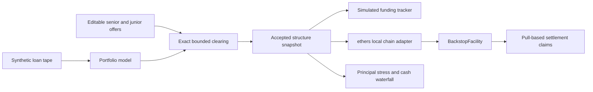

# Architecture

## Components

The React/TypeScript application runs on Vite. A browser-only architecture keeps this single-workspace demo easy to run without service credentials. An authenticated server and durable shared database are future work; localStorage is deliberately limited to synthetic demo data.

`src/domain/` contains typed financial logic, input validation, clearing, and funding transitions. `src/data/seed.ts` supplies synthetic loans and reproducible scenarios. `src/adapters/intelligence.ts` explains computed results without an LLM. `src/chain.ts` sends actual local transactions, records receipts, and checks each distribution against the client model. The chain adapter is loaded only when needed.

`contracts/MockUSD.sol` is an unrestricted test token with two decimals. `contracts/BackstopFacility.sol` holds immutable accepted participant allocations, rates, fees, a terms hash, and funding deadline. It disburses the fully funded stack to the originator. The originator reports cash collections by transferring tokens back. After 365 days, settlement allocates claims; participants withdraw independently.

## Data and state

Accepted terms are copied so later offer changes cannot alter the accepted structure in normal app use. Editing is disabled after acceptance. The browser can be reset and its storage can be tampered with; it is not an immutable ledger or an authorization system. The Solidity contract is the source of truth for its own deposited funds and claims.

A single accepted browser deal prevents demo capital being allocated to two concurrent structures. On chain, transferred ERC-20 balances cannot simultaneously remain available in an investor's wallet. The automated demo mints fresh test tokens for each isolated run. It does not implement a production multi-deal capital reservation service.

## Networks and adapters

The automated UI wallet flow is restricted to chain 31337 at `127.0.0.1:8545`, uses unlocked local signers, and never reads private keys. It advances time only on that local chain. A testnet deployment script accepts credentials from the local environment and checks chain 1449000. A separate receipt verifier can use QuickNode or another compatible RPC. Neither claims a network transaction before receiving an actual mined receipt.

BACKSTOP is a standalone EVM facility. It does not create a native XRPL `Loan`, `Vault`, or `LoanBroker`. A future native integration would need an authorized broker, verified amendment support, a compatible asset, and an explicit bridge/custody design. The current funded junior stack cannot simply be relabeled a separate XLS-66 broker reserve without changing the accounting.
